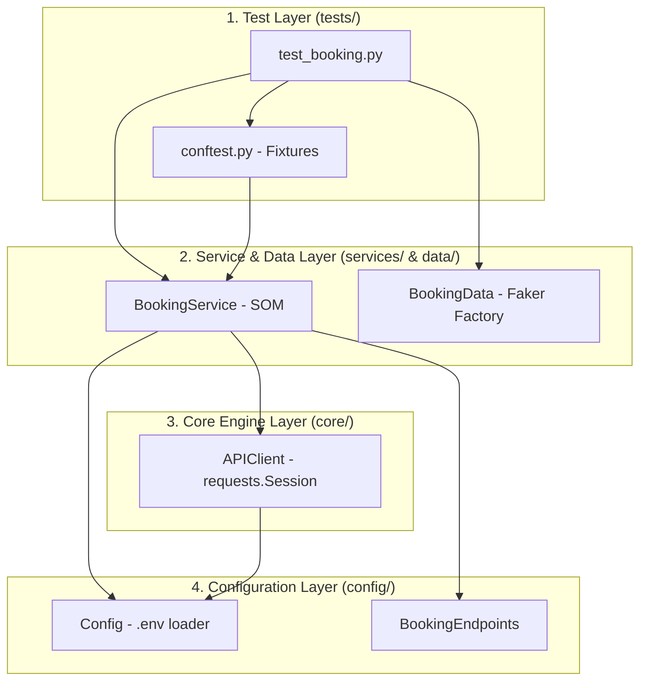
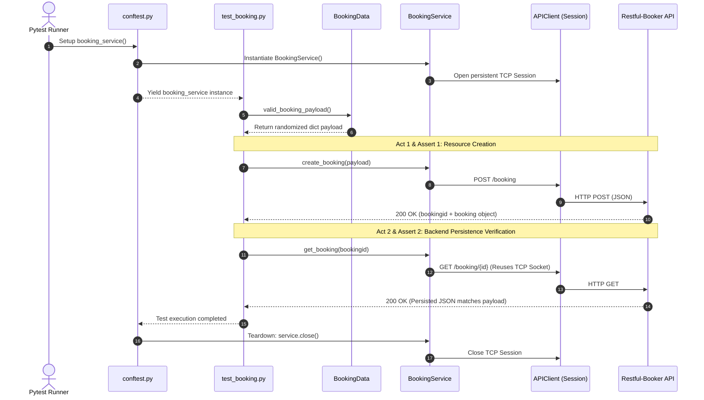
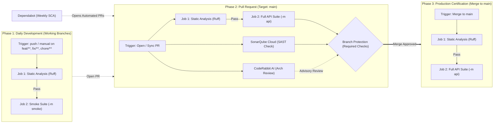

# Python Test Automation Framework (API & UI)

[](https://github.com/rwarthon/selenium-python-framework/actions/workflows/ci.yml)
[](https://sonarcloud.io/summary/new_code?id=rwarthon_selenium-python-framework)
[](https://www.python.org/)
[](https://github.com/astral-sh/ruff)
[](https://opensource.org/licenses/MIT)

Production-grade test automation framework built with **Python**, **Pytest**, and **Requests** (expanding to **Selenium WebDriver**). Designed with strict architectural layering, reusable HTTP connection pooling, dynamic data generation, and automated CI quality gates.

---

## Architectural Design & Principles

This framework avoids script-level coupling by enforcing a **Strict 4-Layer Architecture**:

1. **Test Layer (`tests/`)**: Contains pure test logic following the **AAA (Arrange-Act-Assert)** pattern. Tests never interact directly with HTTP libraries, URLs, or credentials.
2. **Service Layer (`services/` & `data/`)**: Implements the **Service Object Model (SOM)** for business domain operations and dynamic **Test Data Factories** powered by `Faker`.
3. **Core Layer (`core/`)**: Wraps low-level technical drivers (`requests.Session` for TCP connection pooling and future Selenium WebDriver managers).
4. **Configuration Layer (`config/`)**: Centralizes environment variables (`.env`), timeouts, and static endpoint routing.

### Layered Architecture Diagram



---

## Execution Sequence Flow (Smoke Test Lifecycle)

The following sequence diagram illustrates how fixtures, data factories, and persistence verification interact during a test run without leaking technical details into the test layer:



---

## CI & DevSecOps Governance Architecture

The repository enforces an automated **Shift-Left Quality & Security Model** ("Swiss Cheese" defense-in-depth) across a **3-Phase Execution Lifecycle**:

### 3-Phase Pipeline Flow



### Multi-Layered Quality & Security Controls (Swiss Cheese Model)

| Diagram Node / Control | Tooling & Configuration | Governance Objective | Enforcement Scope |
| :--- | :--- | :--- | :--- |
| **`Job 1: Static Analysis (Ruff)`** | `ruff check` & `ruff format --check` | Enforces Python linting (Pyflakes / pycodestyle) and consistent code formatting before spinning up test runners. | Local CLI & GitHub Actions (`Required Check`) |
| **`Job 2: Smoke / Full API Suite`** | `pytest -m smoke` / `pytest -m api` | Executes fast Smoke checks on branch pushes and full E2E API regression on Pull Requests and `main`. | Local CLI & GitHub Actions (`Required Check`) |
| **`SonarQube Cloud (SAST Check)`** | SonarQube Cloud GitHub App + `.sonarcloud.properties` | Runs automatic SAST analysis on source (`config`, `core`, `data`, `services`) and test (`tests`) scopes on Python 3.12 for bugs, hotspots, and duplication. | Pull Requests & `main` (`Required Check`) |
| **`CodeRabbit AI (Arch Review)`** | `.coderabbit.yaml` | Audits Pull Requests against custom path rules to prevent 4-layer violations (e.g., blocking direct `requests` calls in `tests/`). | Every Pull Request (`Advisory Review`) |
| **`Dependabot (Weekly SCA)`** | `.github/dependabot.yml` + Hardened `ci.yml` | Automated weekly dependency PRs, immutable 40-char Action SHAs, `--only-binary :all:` wheel installation, and `contents: read` token permissions. | Automated Weekly PRs & CI Runtime |

---

## Project Structure

```text
selenium-python-framework/
├── .github/
│   ├── dependabot.yml         # Automated SCA weekly checks (pip & github-actions)
│   └── workflows/
│       └── ci.yml             # Hardened CI Pipeline (Job 1: Ruff -> Job 2: Pytest)
├── config/
│   ├── config.py              # Environment variable loader and global settings
│   └── endpoints.py           # Centralized API endpoint routes
├── core/
│   └── api_client.py          # Generic HTTP wrapper over requests.Session
├── data/
│   └── booking_data.py        # Dynamic payload factory using Faker
├── services/
│   └── booking_service.py     # Business domain layer for Restful-Booker API
├── tests/
│   ├── conftest.py            # Dependency injection and lifecycle fixtures
│   └── booking_api/
│       └── test_booking.py    # API smoke and functional regression suites
├── .coderabbit.yaml           # AI Reviewer architectural instructions per layer
├── .env.example               # Template for required environment variables
├── .gitignore                 # Git exclusion rules
├── .sonarcloud.properties     # SonarQube Cloud Python 3.12 & scope configuration
├── LICENSE                    # MIT Open Source License
├── pytest.ini                 # Pytest configuration and registered markers
├── README.md                  # Architecture, governance, and execution documentation
└── requirements.txt           # Frozen project dependencies (pip freeze)
```

---

## Tech Stack & Quality Tooling

*(Exact frozen library versions are managed in `requirements.txt` and monitored weekly by Dependabot)*

- **Language:** Python 3.12
- **Test Runner:** `pytest`
- **HTTP Client:** `requests` (Persistent `Session` pooling)
- **Data Generation:** `Faker`
- **Static Analysis & Formatter:** `Ruff` (Python linter for Pyflakes/pycodestyle and code formatter)
- **CI & DevSecOps Governance:** GitHub Actions, SonarQube Cloud (SAST), CodeRabbit AI (Arch Review), Dependabot (SCA)

---

## Local Setup & Installation

### 1. Clone the repository and create a virtual environment

```bash
git clone https://github.com/rwarthon/selenium-python-framework.git
cd selenium-python-framework

# macOS / Linux
python3 -m venv venv
source venv/bin/activate

# Windows (PowerShell)
python -m venv venv
.\venv\Scripts\Activate.ps1

# Windows (CMD)
python -m venv venv
venv\Scripts\activate.bat
```

### 2. Install dependencies

```bash
pip install -r requirements.txt
```

### 3. Configure environment variables

Copy the template file `.env.example` to a new `.env` file and populate the placeholders (`???` and `X`) with your target environment values:

```bash
# macOS / Linux / Windows (PowerShell)
cp .env.example .env

# Windows (CMD)
copy .env.example .env
```

---

## Running Tests & Quality Checks Locally

### 1. Run Static Analysis & Format Check (Job 1 Gate)

```bash
ruff check .
ruff format --check .
```

### 2. Run Fast Smoke Suite (Phase 1 Scope)

```bash
pytest -m smoke
```

### 3. Run Full API Regression Suite (Phase 2 & 3 Scope)

```bash
pytest -m api
```