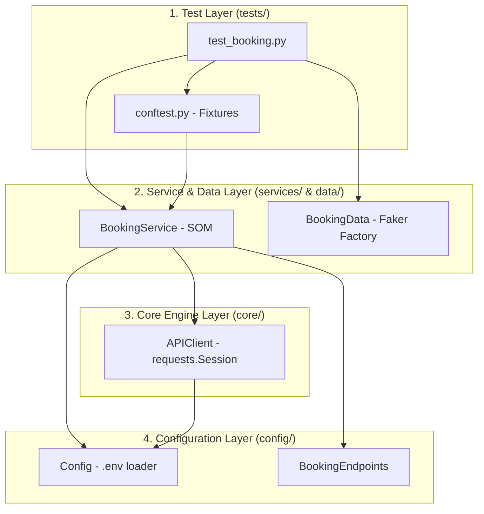
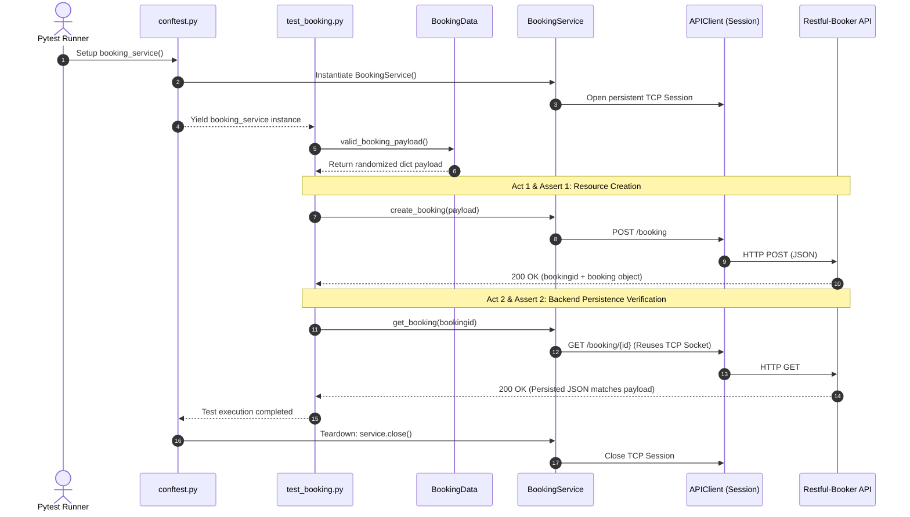

# Python Test Automation Framework (API & UI)

Production-grade test automation framework built with **Python**, **Pytest**, and **Requests** (expanding to **Selenium WebDriver**). Designed with strict architectural layering, reusable HTTP connection pooling, dynamic data generation, and automated CI quality gates.

---

## Architectural Design & Principles

This framework avoids script-level coupling by enforcing a **Strict 4-Layer Architecture**:

1. **Test Layer (`tests/`)**: Contains pure test logic following the **AAA (Arrange-Act-Assert)** pattern. Tests never interact directly with HTTP libraries, URLs, or credentials.
2. **Service Layer (`services/` & `data/`)**: Implements the **Service Object Model (SOM)** for business domain operations and dynamic **Test Data Factories** powered by `Faker`.
3. **Core Layer (`core/`)**: Wraps low-level technical drivers (`requests.Session` for TCP connection pooling and future Selenium WebDriver managers).
4. **Configuration Layer (`config/`)**: Centralizes environment variables (`.env`), timeouts, and static endpoint routing.

### Layered Architecture Diagram



---

## Execution Sequence Flow (Smoke Test Lifecycle)

The following sequence diagram illustrates how fixtures, data factories, and persistence verification interact during a test run without leaking technical details into the test layer:



---

## Project Structure

```text
selenium-python-framework/
├── config/
│   ├── config.py              # Environment variable loader and global settings
│   └── endpoints.py           # Centralized API endpoint routes
├── core/
│   └── api_client.py          # Generic HTTP wrapper over requests.Session
├── data/
│   └── booking_data.py        # Dynamic payload factory using Faker
├── services/
│   └── booking_service.py     # Business domain layer for Restful-Booker API
├── tests/
│   ├── conftest.py            # Dependency injection and lifecycle fixtures
│   └── booking_api/
│       └── test_booking.py    # API smoke and functional test suites
├── .env.example               # Template for required environment variables
├── .gitignore                 # Git exclusion rules
├── pytest.ini                 # Pytest configuration and registered markers
└── requirements.txt           # Pinned project dependencies
```

---

## Tech Stack & Quality Tooling

*(Exact pinned library versions are managed in `requirements.txt`)*

* **Language:** Python 3.10+
* **Test Runner:** `pytest`
* **HTTP Client:** `requests` (Persistent `Session` pooling)
* **Data Generation:** `Faker`
* **Static Analysis & Linting:** `Ruff` (PEP 8, `isort`, `pyupgrade`, `flake8-pytest-style`)
* **CI/CD:** GitHub Actions

---

## Local Setup & Installation

### 1. Clone the repository and create a virtual environment

```bash
git clone <repository-url>
cd selenium-python-framework
python3 -m venv venv
source venv/bin/activate
```

### 2. Install dependencies

```bash
pip install -r requirements.txt
```

### 3. Configure environment variables

Copy the template file `.env.example` to a new `.env` file and populate the placeholders (`???` and `X`) with your target environment values:

```bash
cp .env.example .env
```

---

## Running Tests & Quality Checks

### Run Smoke Test Suite

```bash
pytest -m smoke
```

### Run All API Tests

```bash
pytest -m api
```

### Run Static Code Analysis (Ruff)

```bash
ruff check .
```